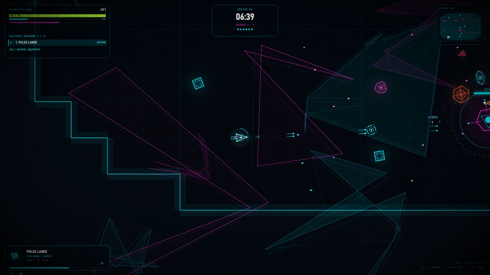

# NEON NEXUS

[](https://taggedzi.github.io/neon-nexis/)
[](https://github.com/taggedzi/neon-nexis/releases/latest)
[](https://github.com/taggedzi/neon-nexis/actions/workflows/release.yml?query=branch%3Amain)
[](https://github.com/taggedzi/neon-nexis/issues)
[](docs/work-to-be-done/README.md)
[](LICENSE)

A browser-based, top-down survival shooter with neon wireframe visuals,
procedural sectors, and synthesized audio. Survive enemy waves, collect equipment,
gain automatic upgrades, and push into increasingly difficult sectors.



This is a solo hobby project, built with plain JavaScript, HTML5 Canvas, CSS,
and Web Audio. Development and support happen as time allows.

[Play online](https://taggedzi.github.io/neon-nexis/) or get both package variants
from [GitHub Releases](https://github.com/taggedzi/neon-nexis/releases/latest).
The Pages site offers solo play; co-op needs a separately configured PHP
introduction service.

## Run locally

Clone or download this repository, then serve its root with a static HTTP server.
For example, with Python 3 installed:

```sh
git clone https://github.com/taggedzi/neon-nexis.git
cd neon-nexis
python3 -m http.server --bind 127.0.0.1 8000
```

Open [localhost:8000](http://localhost:8000/), click **Engage**, and choose
**New Run**. Stop the server with Ctrl+C. If port 8000 is occupied, choose another
port and use it in the browser URL. No package installation or build step is
required for solo play. Graphics and audio are generated locally. For co-op
setup, see the [PHP introduction guide](docs/work-to-be-done/015-php-coop-introduction.md).

Optional recorded music can be prepared for a local website build; see the
[soundtrack guide](docs/music.md). The repository and GitHub release packages
retain procedural music and exclude the optional soundtrack.

Use a current desktop browser with Canvas and Web Audio support. Gamepad support
depends on the browser and device; physical-controller validation is still pending.

## Browser support targets

These are development goals, not compatibility or performance guarantees. Browser
checks must record the actual version and environment tested.

| Browser | Desired target | Validation status |
| --- | --- | --- |
| Firefox | Current stable desktop release | Cross-browser acceptance pending |
| Google Chrome | Current stable desktop release | Cross-browser acceptance pending |
| Chromium | Current stable desktop release | Cross-browser acceptance pending |

This matrix does not promise support for every operating system, controller,
mobile device, or older browser version.

## Play

Choose a ship and color, stay mobile, and build your loadout from immediate
equipment rewards and stackable passives. Each hull keeps its primary, two
additional offensive slots, and a separate defensive quick-use slot. Levels
automatically grant passives; original teammates share progression without
reward-choice menus. Clear a sector by destroying its Null Anchors or surviving
the sector timer.

| Default keyboard / mouse input | Action |
| --- | --- |
| W / A / S / D | Move |
| Mouse | Aim |
| Left mouse button or F | Fire |
| Space | Dash |
| Q / E | Previous / next weapon |
| 1 / 2 / 3 | Select offensive slot |
| I | Inventory |
| R | Activate defense once |
| Escape | Pause |

Keyboard and controller bindings, movement and firing modes, audio, and visual
options are available in **Settings**. The in-game control reference reflects
your current bindings. Controllers use the left stick to move and the right
stick to aim, with configurable buttons for other actions.
By default, bumpers cycle weapons, D-pad left/up/right selects a slot, and X
activates defense. Release a defensive button before pressing it again.

Checkpoints and saved ships from the old choice-based progression are
incompatible. The game offers to export the affected original data before
removal, or explicitly remove it without export. Settings and profile data are
preserved; old earned builds are not silently converted or trimmed.

Saves and settings stay in this browser. Continue in the same browser profile
and at the same address, including port. Clearing site data can remove progress.
Settings → Data can export one file and import it in another browser. Export
starts a download. The game cannot confirm that the file reached disk. Nothing
syncs on its own.

Unsupported or unreadable saves offer **Export and remove** or **Remove without
export**. Compatible saves continue to work; developers own format compatibility.
Settings are kept when an unsupported checkpoint is removed. A voluntary backup
includes both the checkpoint and settings.

## Development and releases

Use Node.js 24 or newer for development checks. From the repository root, run:

```sh
npm ci --ignore-scripts
node tools/ci/install-hooks.cjs
npx playwright install chromium firefox
npm run check
```

The suite covers syntax, lint, Node regression tests, and Playwright checks in
Chromium and Firefox. The local pre-push hook checks that the task branch contains
current `origin/main` and adds no merge commits, then runs the suite. Eligible
documentation-only pushes skip the suite after the branch checks. See the
[local check rules](docs/development-and-releases.md#local-checks).

Start task branches from freshly updated `main`, keep one pull request open at
a time, and rebase onto `origin/main` before pushing when `main` has advanced.
Pull requests land by rebase. See the
[branch process](docs/development-and-releases.md#one-branch-current-with-main).

Publishing requires a manual **Publish game** dispatch on `main`. The workflow
checks both staged variants before deploying the selected one to GitHub Pages.
**Minify** defaults on. After Pages succeeds, the same run publishes both ZIPs
on a matching GitHub Release. Versions use `YYYY.MM.DD.####` with the New York
date and a four-digit workflow run number. See the
[release guide](docs/development-and-releases.md#publish-a-release).

The **Publish game** badge reports the manual workflow result on `main`.
Routine pushes and pull requests rely on local checks. The **Play** badge opens
the hosted game, and the **Latest release** badge opens the downloads.

## Project status and contributions

The [local backlog](docs/work-to-be-done/README.md) tracks implementation status
and validation evidence. The **GitHub issues** badge counts open GitHub issues.
Live multiplayer progression validation is waiting for other players and the
required devices and environments. See [GitHub issue #75](https://github.com/taggedzi/neon-nexis/issues/75).

Bug reports, focused improvements, and documentation fixes are welcome. Read
[Contributing](CONTRIBUTING.md) before opening a pull request and follow the
[Code of Conduct](CODE_OF_CONDUCT.md). Report vulnerabilities using the
[Security Policy](SECURITY.md), rather than a public issue.

## Source layout

- `index.html` — page shell and script loading.
- `css/` — interface styling.
- `js/` — game logic, procedural assets, input, rendering, and interface.
- `tools/` — development checks and performance tooling.
- `docs/work-to-be-done/` — local issue tracker and validation records.

Developers and AI contributors should read the
[web development style guide](docs/web-development-style-guide.md).

## License

[MIT](LICENSE). Copyright © 2026 Matthew Craig.
